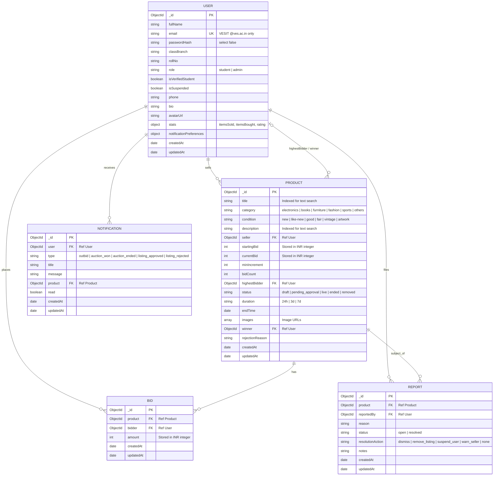

# CampusBid Database Architecture & Schema Specification

This document details the MongoDB data models, indexes, relationships, and design decisions used in CampusBid for the Mini Project Evaluation viva.

---

## 1. Entity-Relationship (ER) Diagram

---

## 2. Collections and Field Definitions

### 2.1 `users` Collection
- **`fullName`** (`String`, Required, Trimmed): Student or Administrator full name.
- **`email`** (`String`, Required, Unique, Lowercase, Trimmed): Must end with `@ves.ac.in`. Enforces VESIT-only access.
- **`passwordHash`** (`String`, Required, `select: false`): Bcrypt salted hash (cost factor 10). Never returned by queries unless explicitly selected.
- **`role`** (`String`, Enum: `student`, `admin`, Default: `student`): Role-based access control.
- **`classBranch`** (`String`): Academic division and branch (e.g., `D12C / CMPN`).
- **`rollNo`** (`String`): Roll number or student identifier.
- **`isVerifiedStudent`** (`Boolean`, Default: `true`): Identity verification flag.
- **`isSuspended`** (`Boolean`, Default: `false`): Administrative account suspension flag.
- **`phone`**, **`bio`**, **`avatarUrl`**: Student contact and profile fields.
- **`stats`**: Summary statistics `{ itemsSold, itemsBought, rating }`.
- **`notificationPreferences`**: Opt-ins `{ outbidAlerts, auctionEndingAlerts, newMessageAlerts }`.
- **`toJSON` Transform**: Automatically maps `_id` to string `id`, calculates `memberSince`, and removes `passwordHash` and `__v`.

### 2.2 `products` Collection
- **`title`** (`String`, Required): Name of the item.
- **`category`** (`String`, Enum: `electronics`, `books`, `furniture`, `fashion`, `sports`, `others`).
- **`condition`** (`String`, Required, Default: `good`).
- **`description`** (`String`, Required): Item details, warranty, condition notes.
- **`seller`** (`ObjectId`, Ref: `User`, Required): Seller's user ID.
- **`startingBid`** (`Number`, Integer Rupees, Min 1): Initial auction floor price.
- **`currentBid`** (`Number`, Integer Rupees): Highest placed bid or starting bid if no bids yet.
- **`minIncrement`** (`Number`, Integer Rupees, Default: 50): Required step for next bid.
- **`bidCount`** (`Number`, Default: 0): Total count of placed bids.
- **`highestBidder`** (`ObjectId`, Ref: `User`, Default: `null`).
- **`status`** (`String`, Enum: `draft`, `pending_approval`, `live`, `ended`, `removed`, Default: `pending_approval`).
- **`duration`** (`String`, Enum: `24h`, `3d`, `7d`).
- **`endTime`** (`Date`, Default: `null`): Computed when listing is approved or published.
- **`images`** (`[String]`): URLs to uploaded product images.
- **`winner`** (`ObjectId`, Ref: `User`, Default: `null`): Set upon auction completion.
- **`rejectionReason`** (`String`): Note from admin if listing is rejected during moderation.

### 2.3 `bids` Collection
- **`product`** (`ObjectId`, Ref: `Product`, Required).
- **`bidder`** (`ObjectId`, Ref: `User`, Required).
- **`amount`** (`Number`, Integer Rupees, Min 1, Required).
- **`timestamps`**: `createdAt` records exact server-side timestamp of bid arrival.

### 2.4 `notifications` Collection
- **`user`** (`ObjectId`, Ref: `User`, Required): Notification recipient.
- **`type`** (`String`, Enum: `outbid`, `auction_won`, `auction_ended`, `listing_approved`, `listing_rejected`).
- **`title`** (`String`, Required), **`message`** (`String`, Required).
- **`product`** (`ObjectId`, Ref: `Product`, Optional): Linked auction item.
- **`read`** (`Boolean`, Default: `false`).

### 2.5 `reports` Collection
- **`product`** (`ObjectId`, Ref: `Product`, Required).
- **`reportedBy`** (`ObjectId`, Ref: `User`, Required).
- **`reason`** (`String`, Required).
- **`status`** (`String`, Enum: `open`, `resolved`, Default: `open`).
- **`resolutionAction`** (`String`, Enum: `dismiss`, `remove_listing`, `suspend_user`, `warn_seller`, `none`).
- **`notes`** (`String`).

---

## 3. Indexing Strategy

| Collection | Index Fields | Type | Purpose |
| :--- | :--- | :--- | :--- |
| `users` | `email: 1` | Unique | Prevent duplicate registrations and speed up login lookups |
| `products` | `{ status: 1, endTime: 1 }` | Compound | Fast polling by background sweeper (`AUCTION_SWEEP_MS`) to close ended auctions |
| `products` | `category: 1` | Single | Filter auctions by category on browse/home pages |
| `products` | `{ title: "text", description: "text" }` | Text | Full-text search across product catalog |
| `bids` | `{ product: 1, amount: -1 }` | Compound | Rapid lookup of bid history and highest bid per auction |
| `notifications` | `{ user: 1, read: 1, createdAt: -1 }` | Compound | Real-time unread notification badge queries |
| `reports` | `{ status: 1, createdAt: -1 }` | Compound | Admin moderation queue sorting |

---

## 4. Design Decisions Defensible in Viva

1. **Integer Rupees vs Floats**: All money is stored as integer rupees to eliminate IEEE-754 floating point rounding inaccuracies. Client formats with `toLocaleString('en-IN')`.
2. **References vs Embedding for Bids**: Bids are stored in a separate collection referenced by `product` and `bidder`. Embedding bids within `Product` documents could risk exceeding MongoDB's 16MB document size limit on active auctions and causes write contention.
3. **Atomic Concurrency for Bidding**: When placing a bid, the server executes a single atomic `findOneAndUpdate` filter matching `{ _id: productId, status: 'live', endTime: { $gt: now }, currentBid: { $lte: bidAmount - minIncrement } }`. This eliminates race conditions without distributed locks.
4. **Data Isolation and Security**: Sensitive user credentials (`passwordHash`) are marked `select: false` at the schema level and stripped during `toJSON` serialization.
